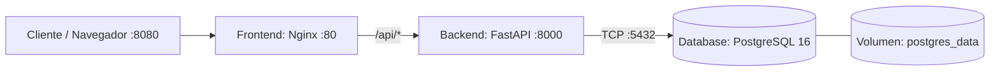

# ACI606 - Docker Rescue Challenge

Aplicación web multi-servicio recuperada y orquestada mediante Docker Compose.

## Arquitectura Final



**Flujo de comunicación:**
`Frontend (Nginx :8080 -> :80)` ➔ `Backend (FastAPI :8000)` ➔ `Database (PostgreSQL :5432 + volumen persistente)`

---

## Cómo iniciar la aplicación (Arranque limpio)

1. Clonar el repositorio y entrar al directorio del proyecto:
   ```bash
   git clone https://github.com/jose0502/Cloud-Computing-Catedra-2.git
   cd Cloud-Computing-Catedra-2
   ```

2. Crear el archivo de variables de entorno a partir de la plantilla:
   ```bash
   cp .env.example .env
   ```

3. Construir las imágenes y levantar los servicios en segundo plano:
   ```bash
   docker compose up --build -d
   ```

---

## Cómo verificar el funcionamiento

1. Confirmar que todos los contenedores estén activos y saludables (`healthy`):
   ```bash
   docker compose ps
   ```

2. Validar la comunicación entre capas (Frontend ➔ Backend ➔ PostgreSQL):
   ```bash
   # Verificar frontend (HTTP 200)
   curl -I http://localhost:8080/

   # Verificar salud de la API
   curl -s http://localhost:8080/api/health

   # Consultar registros en PostgreSQL
   curl -s http://localhost:8080/api/items
   ```

3. Revisar logs en caso de diagnóstico:
   ```bash
   docker compose logs -f
   ```

4. Acceder desde el navegador a: `http://localhost:8080`

---

## Cómo detener y recrear la solución

* **Detener la aplicación conservando los datos persistentes:**
  ```bash
  docker compose down
  ```

* **Recrear la solución desde cero (manteniendo el volumen `postgres_data`):**
  ```bash
  docker compose down
  docker compose up --build -d
  ```

* **Limpieza total (elimina contenedores, redes y volúmenes de datos):**
  ```bash
  docker compose down -v
  ```